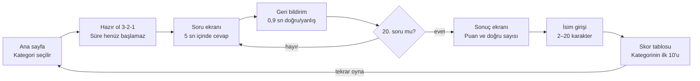
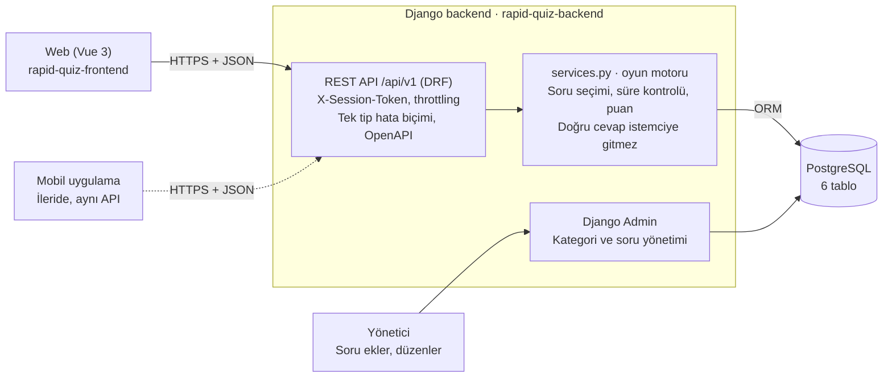

# Rapid Quiz — Proje Dokümanı

28 Ekim 2026 · Süleyman Susuz

## 1. Proje özeti

Rapid Quiz, 5 kategoride 20'şer soru soran ve her soruya yalnızca 5 saniye süre tanıyan, üyeliksiz bir bilgi yarışmasıdır. Kullanıcı quiz'i bitirince puanını görür, adını girer ve en iyi 10 skoru gösteren skor tablosuna geçer.

| Konu | Karar |
| --- | --- |
| Kategoriler | Yazılım, Yapay Zeka, Bilgisayar Mühendisliği, Ülkeler, Fizik |
| Oturum başına soru | 20, her biri ayrı ekranda |
| Soru süresi | 5 saniye |
| Üyelik | Yok; sadece quiz bitince isim sorulur |
| Skor tablosu | İlk 10 skor |
| Backend | Python, Django + Django REST Framework (ayrı repo) |
| Frontend | Vue.js 3 (ayrı repo) |
| Veritabanı | PostgreSQL |
| İstemciler | Web şimdi, mobil uygulama sonra; ikisi aynı API'yi kullanır |
| Hedef kitle | Teknolojiye meraklı gençler ve üniversite öğrencileri |

Temel mimari ilke: doğru cevap, süre kontrolü ve puan hesabı tamamen sunucuda yapılır. İstemci (web ya da mobil) yalnızca soruyu gösterir ve cevabı iletir; bu sayede hile zorlaşır ve mobil uygulama aynı kuralları otomatik olarak devralır.

## 2. Kapsam

İlk sürüm (MVP) web üzerinde eksiksiz oynanabilir bir quiz ve skor tablosu sunar; backend ise ilk günden mobil istemciye hazır kurulur.

**Kapsama dahil**

- Kategori seçimi (5 kategori)
- Kategori başına 20 soruluk oturum; sorular tek tek, geri dönüşsüz
- Soru başına 5 saniyelik geri sayım, süre dolunca otomatik geçiş
- Her cevaptan sonra kısa doğru/yanlış geri bildirimi
- Quiz sonunda puan, doğru sayısı ve isim girişi
- Kategori bazlı ilk 10 skor tablosu
- Soruların Django Admin üzerinden yönetimi ve JSON'dan toplu yükleme
- Versiyonlu REST API (`/api/v1/`) ve OpenAPI dokümantasyonu

**Kapsam dışı**

- Kayıt, giriş, kullanıcı profili, şifre
- Çok oyunculu / canlı yarışma modu
- Sosyal medya girişi, arkadaş ekleme
- Ödeme, reklam, push bildirim
- Mobil uygulamanın kendisi (bu dokümanda yalnızca backend'in ona hazırlığı ele alınır)

## 3. Kullanıcı akışı ve ekranlar

Uygulama 4 sayfadan (ana sayfa, quiz, sonuç, skor tablosu) oluşur; quiz sayfası içinde hazır ol, soru ve geri bildirim durumları döner.



Soru ekranı ile geri bildirim arasındaki döngü 20 kez döner; önceki soruya dönmek ya da soruyu atlamak mümkün değildir. Ana sayfadan oynamadan da skor tablosuna geçilebilir.

## 4. Oyun kuralları ve puanlama

Doğru cevap 100 puan ve hıza göre en fazla 50 bonus puan getirir; yanlış cevap ve süre aşımı 0 puandır. Bir oturumda alınabilecek en yüksek puan 20 × 150 = 3000'dir.

| Kural | Değer |
| --- | --- |
| Soru sayısı | 20 (kategori havuzundan rastgele, tekrarsız) |
| Şık sayısı | 4, sırası her oturumda karıştırılır |
| Süre | 5000 ms, sunucu saatiyle ölçülür |
| Ağ toleransı | +700 ms (bu süre içinde gelen cevap kabul edilir, bonusu sıfırdır) |
| Doğru cevap | 100 puan + hız bonusu (0–50) |
| Yanlış cevap | 0 puan, eksi puan yok |
| Süre aşımı | 0 puan, soru otomatik kapanır, sıradaki gelir |
| Geri dönme / atlama | Yok |
| Eşitlik bozma | 1) yüksek puan, 2) düşük toplam cevap süresi, 3) daha erken bitiren |

Hız bonusu sunucuda şöyle hesaplanır (t = sorunun sunulmasından cevabın sunucuya ulaşmasına kadar geçen süre, ms):

```text
puan = 100 + round(50 × max(0, 5000 − t) / 5000)
```

Örnek: 2 saniyede verilen doğru cevap 100 + 30 = 130 puan alır.

Sorular 5 saniyede okunabilmeli: soru metni en fazla 90 karakter, şıklar en fazla 40 karakter olmalı. Bu sınır veritabanında ve admin formunda doğrulanır.

## 5. Sistem mimarisi

Frontend ve backend iki ayrı repo olarak geliştirilir ve ayrı yayınlanır; aralarındaki tek sözleşme HTTPS üzerinden JSON konuşan REST API'dir.



Web ve mobil istemci aynı API'ye bağlanır (kesikli çizgi: ileride). Oyun kurallarının tamamı `services.py` katmanındadır; view'lar yalnızca isteği doğrular ve bu katmanı çağırır, böylece web ve mobil davranışı her zaman aynı olur.

## 6. Veri modeli (PostgreSQL)

Altı tablo yeterlidir: içerik için 3 (kategori, soru, şık), oyun için 3 (oturum, oturumdaki soru, skor). Kullanıcı tablosu yoktur.

**categories**

| Alan | Tip | Not |
| --- | --- | --- |
| id | bigint PK | |
| slug | varchar(50), unique | `yazilim`, `yapay-zeka`, `bilgisayar-muhendisligi`, `ulkeler`, `fizik` |
| name | varchar(60) | Ekranda görünen ad |
| description | varchar(200) | Kart alt metni |
| color | varchar(7) | Kategori rengi (hex) |
| icon | varchar(40) | İkon adı |
| sort_order | smallint | Ana sayfadaki sıra |
| is_active | boolean | |

**questions**

| Alan | Tip | Not |
| --- | --- | --- |
| id | bigint PK | |
| category_id | FK → categories | index |
| text | varchar(90) | 5 saniyede okunabilir uzunluk |
| difficulty | smallint (1–3) | İleride dengeli soru seçimi için |
| explanation | varchar(200), null | Opsiyonel kısa açıklama |
| is_active | boolean | Pasif sorular oturuma girmez |
| created_at, updated_at | timestamptz | |

**choices**

| Alan | Tip | Not |
| --- | --- | --- |
| id | bigint PK | |
| question_id | FK → questions | |
| text | varchar(40) | |
| is_correct | boolean | Soru başına tam 1 doğru (kısıt + admin doğrulaması) |

**quiz_sessions**

| Alan | Tip | Not |
| --- | --- | --- |
| id | uuid PK | İstemciye verilen oturum kimliği |
| token_hash | varchar(64) | Gizli oturum anahtarının SHA-256 özeti |
| category_id | FK → categories | |
| status | varchar(12) | `active`, `finished`, `submitted`, `expired` |
| current_index | smallint | 0–19 |
| total_score | integer | |
| correct_count | smallint | |
| total_response_ms | integer | Eşitlik bozmak için |
| platform | varchar(10) | `web`, `ios`, `android` |
| ip_hash | varchar(64) | Rate limit ve kötüye kullanım takibi; ham IP saklanmaz |
| started_at, finished_at | timestamptz | |

**session_questions**

| Alan | Tip | Not |
| --- | --- | --- |
| id | bigint PK | |
| session_id | FK → quiz_sessions | unique(session_id, position) |
| question_id | FK → questions | |
| position | smallint | 0–19 |
| choice_order | smallint[] | Bu oturumdaki şık sırası |
| served_at | timestamptz, null | Soru ilk istendiğinde set edilir |
| answered_at | timestamptz, null | |
| selected_choice_id | FK → choices, null | null = süre aşımı |
| is_correct | boolean | |
| response_ms | integer | |
| points | smallint | |

**score_entries**

| Alan | Tip | Not |
| --- | --- | --- |
| id | bigint PK | |
| session_id | OneToOne → quiz_sessions | Bir oturum tek skor yazar |
| category_id | FK → categories | |
| player_name | varchar(20) | |
| score | integer | |
| correct_count | smallint | |
| total_response_ms | integer | |
| created_at | timestamptz | |

Skor tablosu sorgusu için bileşik index: `(category_id, score DESC, total_response_ms ASC, created_at ASC)`. Bu index ile ilk 10 sorgusu tablo büyüse de milisaniyeler içinde döner.

## 7. API tasarımı

Tüm uç noktalar `/api/v1/` altında, JSON konuşan, çerez kullanmayan bir REST API'dir; web ve mobil istemci aynı uç noktaları kullanır. Oturuma ait isteklerde `X-Session-Token` başlığı zorunludur.

| Metot | Uç nokta | Amaç |
| --- | --- | --- |
| GET | `/api/v1/categories/` | Aktif kategorileri listeler |
| POST | `/api/v1/sessions/` | Yeni quiz oturumu başlatır, oturum kimliği ve gizli token döner |
| GET | `/api/v1/sessions/{id}/question/` | Sıradaki soruyu verir; ilk istekte süreyi başlatır |
| POST | `/api/v1/sessions/{id}/answer/` | Cevabı alır, sonucu ve güncel puanı döner |
| GET | `/api/v1/sessions/{id}/result/` | Biten oturumun puan özetini döner |
| POST | `/api/v1/sessions/{id}/score/` | İsmi kaydeder, sıralamayı döner |
| GET | `/api/v1/leaderboard/?category={slug}` | Kategorinin ilk 10 skoru |
| GET | `/api/v1/health/` | Sağlık kontrolü (deploy ve izleme için) |
| GET | `/api/v1/schema/`, `/api/v1/docs/` | OpenAPI şeması ve Swagger arayüzü |

**Oturum başlatma**

```json
POST /api/v1/sessions/
{ "category": "yazilim", "platform": "web" }

201 Created
{
  "session_id": "8f0c2a7e-…",
  "session_token": "q9X…",
  "category": { "slug": "yazilim", "name": "Yazılım" },
  "total_questions": 20,
  "time_limit_ms": 5000
}
```

**Soru alma** — cevapta doğru şık bilgisi asla bulunmaz. Aynı soru tekrar istenirse yeni süre başlamaz, kalan süre döner.

```json
GET /api/v1/sessions/{id}/question/

200 OK
{
  "position": 3,
  "total_questions": 20,
  "question": { "id": 412, "text": "HTTP 404 durum kodu neyi ifade eder?" },
  "choices": [
    { "id": 1641, "text": "Sunucu hatası" },
    { "id": 1643, "text": "Kaynak bulunamadı" },
    { "id": 1640, "text": "Yetkisiz erişim" },
    { "id": 1642, "text": "Yönlendirme" }
  ],
  "time_limit_ms": 5000,
  "remaining_ms": 5000,
  "current_score": 260
}
```

**Cevap gönderme** — süre dolunca istemci `choice_id: null` gönderir. İstemci hiç göndermezse, bir sonraki soru isteğinde sunucu önceki soruyu süre aşımı olarak kapatır.

```json
POST /api/v1/sessions/{id}/answer/
{ "question_id": 412, "choice_id": 1643 }

200 OK
{
  "is_correct": true,
  "correct_choice_id": 1643,
  "points": 138,
  "total_score": 398,
  "timed_out": false,
  "is_last": false
}
```

**Skor kaydetme**

```json
POST /api/v1/sessions/{id}/score/
{ "player_name": "Ayşe" }

201 Created
{
  "rank": 4,
  "in_top_10": true,
  "score": 2310,
  "leaderboard": [ { "rank": 1, "player_name": "Mert", "score": 2780, "correct_count": 19 }, "…" ]
}
```

**Hata biçimi** — tüm hatalar aynı yapıda döner; mobil istemci `code` alanına göre davranır, `message` alanını doğrudan gösterebilir.

```json
{ "error": { "code": "session_expired", "message": "Oturum süresi doldu.", "details": {} } }
```

| code | HTTP | Ne zaman |
| --- | --- | --- |
| `validation_error` | 400 | Eksik veya geçersiz alan (ör. isim 2–20 karakter değil) |
| `invalid_token` | 401 | `X-Session-Token` eksik veya yanlış |
| `not_found` | 404 | Oturum veya kategori yok |
| `question_mismatch` | 409 | Gönderilen `question_id` sıradaki soru değil |
| `already_answered` | 409 | Soru zaten cevaplanmış |
| `session_not_finished` | 409 | Bitmemiş oturum için skor kaydı |
| `score_already_submitted` | 409 | İsim ikinci kez gönderildi |
| `session_expired` | 410 | Oturum 10 dakikadan eski |
| `rate_limited` | 429 | İstek sınırı aşıldı |

## 8. Güvenlik ve hile önleme

Üyelik olmadığı için skor tablosu kötüye kullanıma açıktır; bu yüzden puanı etkileyen her karar sunucuda verilir ve istemciden gelen hiçbir süre ya da puan bilgisine güvenilmez.

| Risk | Önlem |
| --- | --- |
| Doğru cevabı ağ trafiğinden okumak | Soru yanıtında `is_correct` hiç yer almaz; doğru şık yalnızca cevaptan sonra döner |
| Süreyi istemcide durdurmak / uzatmak | Süre `served_at` ile sunucu saatinden ölçülür; 5000 + 700 ms sonrası gelen cevap süre aşımı sayılır |
| Sonraki soruyu önceden görmek | Sunucu, mevcut soru kapanmadan sıradakini vermez |
| Aynı soruyu tekrar istemek | İkinci istekte süre sıfırlanmaz, kalan süre döner |
| Başkasının oturumuna müdahale | Her oturumun gizli token'ı var; veritabanında yalnızca SHA-256 özeti tutulur |
| Sahte skor POST'u | Skor yalnızca `finished` durumundaki oturumdan, bir kez ve sunucunun hesapladığı puanla yazılır |
| Bot ile seri oturum açma | DRF throttling: IP başına dakikada 10 oturum, 120 cevap; skor kaydı saatte 20 |
| Yarım kalmış oturumlar | 10 dakikayı geçen `active` oturumlar `expired` olur (her istekte kontrol edilir) |
| Uygunsuz isim | 2–20 karakter, harf/rakam/boşluk/`_` dışı karakter yok, basit Türkçe + İngilizce küfür listesi |
| XSS | İsim her yerde düz metin olarak basılır (Vue `{{ }}`), `v-html` kullanılmaz |
| CORS | Sadece web frontend alan adı izinli; mobil uygulama CORS'tan etkilenmez |
| Gizli bilgiler | `SECRET_KEY`, DB şifresi vb. ortam değişkeninde; repo'da `.env.example` olur, `.env` olmaz |

Prodüksiyonda `DEBUG=False`, HTTPS zorunlu, `SECURE_*` başlıkları açık ve Django Admin varsayılan `/admin/` dışında bir yolda olmalı.

## 9. Backend repo: `rapid-quiz-backend`

Backend, Django Admin dahil tek bir Django projesidir; iş kuralları view'larda değil `services.py` içinde tutulur ki testleri kolay ve mobil/web için ortak olsun.

| Katman | Seçim | Neden |
| --- | --- | --- |
| Dil | Python 3.12+ | |
| Framework | Django 5.2 LTS | Uzun süreli destekli sürüm |
| API | Django REST Framework | Serializer, throttling, hata yönetimi hazır |
| Veritabanı sürücüsü | psycopg 3 | PostgreSQL için güncel sürücü |
| Ayarlar | django-environ | `.env` ile ortam ayrımı |
| CORS | django-cors-headers | Vue frontend'in farklı alan adından erişimi |
| API dokümanı | drf-spectacular | OpenAPI şeması; mobil istemci kodu bundan üretilebilir |
| Sunucu | gunicorn + whitenoise | Prodüksiyon WSGI ve admin statik dosyaları |
| Test | pytest, pytest-django, factory-boy | |
| Kod kalitesi | ruff (lint + format) | |
| Yerel ortam | Docker Compose (PostgreSQL + Django) | |

```text
rapid-quiz-backend/
├── .do/
│   └── app.yaml           # DigitalOcean App Platform tanımı
├── config/
│   ├── settings/
│   │   ├── base.py
│   │   ├── dev.py
│   │   └── prod.py
│   ├── urls.py
│   └── wsgi.py
├── apps/
│   ├── catalog/           # Category, Question, Choice + admin
│   │   ├── models.py
│   │   ├── admin.py
│   │   ├── serializers.py
│   │   └── management/commands/load_questions.py
│   ├── quiz/              # QuizSession, SessionQuestion, oyun kuralları
│   │   ├── models.py
│   │   ├── services.py    # start_session, serve_question, submit_answer, scoring
│   │   ├── serializers.py
│   │   ├── views.py
│   │   ├── throttles.py
│   │   └── management/commands/expire_sessions.py
│   ├── leaderboard/       # ScoreEntry, isim doğrulama, ilk 10
│   └── core/              # hata biçimi, token doğrulama, health
├── data/questions/        # yazilim.json, yapay-zeka.json, …
├── tests/
├── .dockerignore
├── .env.example
├── docker-compose.yml     # yerel geliştirme: Django + PostgreSQL
├── Dockerfile             # yerelde ve DigitalOcean'da aynı imaj
├── requirements.txt       # prodüksiyon bağımlılıkları
├── requirements-dev.txt   # pytest, ruff, factory-boy
├── pyproject.toml         # ruff ve pytest ayarları
├── CLAUDE.md
└── README.md
```

Soru dosyası biçimi (`data/questions/yazilim.json`), `python manage.py load_questions` ile yüklenir:

```json
[
  {
    "text": "HTTP 404 durum kodu neyi ifade eder?",
    "difficulty": 1,
    "choices": ["Kaynak bulunamadı", "Sunucu hatası", "Yetkisiz erişim", "Yönlendirme"],
    "correct": 0
  }
]
```

### Docker ve DigitalOcean App Platform

Backend tek bir Dockerfile'dan imajlanır; aynı imaj yerelde Docker Compose ile, prodüksiyonda DigitalOcean App Platform'da bir **service** bileşeni olarak çalışır. Migration'lar container açılışında değil, her deploy'dan önce çalışan ayrı bir **PRE_DEPLOY job** ile yapılır.

**Dockerfile**

```dockerfile
FROM python:3.12-slim

ENV PYTHONDONTWRITEBYTECODE=1 \
    PYTHONUNBUFFERED=1 \
    PIP_NO_CACHE_DIR=1 \
    PORT=8080

WORKDIR /app

# Önce bağımlılıklar: kod değişince bu katman önbellekten gelir
COPY requirements.txt .
RUN pip install -r requirements.txt

COPY . .

# Admin'in statik dosyaları imaja gömülür, whitenoise sunar
RUN SECRET_KEY=build-only DJANGO_SETTINGS_MODULE=config.settings.prod \
    python manage.py collectstatic --noinput

RUN useradd --create-home appuser
USER appuser

EXPOSE 8080
CMD gunicorn config.wsgi:application --bind 0.0.0.0:${PORT} --workers 2 --timeout 30 --access-logfile -
```

- `psycopg[binary]` kullanılırsa imaja ayrıca `libpq` kurmak gerekmez.
- `collectstatic` build sırasında veritabanına ihtiyaç duymamalı: `prod.py`, `DATABASE_URL` yoksa import sırasında hata vermemeli.
- Container root olmayan kullanıcıyla çalışır.

**.dockerignore**

```text
.git
.github
.venv
__pycache__/
*.pyc
.env
staticfiles/
tests/
.do/
```

**docker-compose.yml (yalnızca yerel geliştirme)**

```yaml
services:
  db:
    image: postgres:16
    environment:
      POSTGRES_DB: rapidquiz
      POSTGRES_USER: rapidquiz
      POSTGRES_PASSWORD: rapidquiz
    ports: ["5432:5432"]
    volumes: [pgdata:/var/lib/postgresql/data]
    healthcheck:
      test: ["CMD-SHELL", "pg_isready -U rapidquiz"]
      interval: 5s
      retries: 10

  web:
    build: .
    command: python manage.py runserver 0.0.0.0:8000
    env_file: .env
    environment:
      DJANGO_SETTINGS_MODULE: config.settings.dev
      DATABASE_URL: postgres://rapidquiz:rapidquiz@db:5432/rapidquiz
    ports: ["8000:8000"]
    volumes: [".:/app"]
    depends_on:
      db:
        condition: service_healthy

volumes:
  pgdata:
```

Yerelde: `docker compose up`, ardından `docker compose exec web python manage.py migrate` ve `load_questions`.

**.do/app.yaml (backend app'i)**

```yaml
name: rapid-quiz-api
region: fra            # Frankfurt, İstanbul'a en yakın bölge

envs:                  # app seviyesinde: service ve job ikisi de görür
  - key: DJANGO_SETTINGS_MODULE
    value: config.settings.prod
  - key: SECRET_KEY
    type: SECRET
    value: ""          # değeri panelden girilir, repo'ya yazılmaz
  - key: DATABASE_URL
    value: ${db.DATABASE_URL}

services:
  - name: api
    github:
      repo: <github-kullanici>/rapid-quiz-backend
      branch: main
      deploy_on_push: true
    dockerfile_path: Dockerfile
    http_port: 8080
    instance_count: 1
    instance_size_slug: <panelde en küçük plan>
    health_check:
      http_path: /api/v1/health/
      initial_delay_seconds: 15
    envs:
      - key: ALLOWED_HOSTS
        value: ${APP_DOMAIN}
      - key: CORS_ALLOWED_ORIGINS
        value: https://<frontend-alan-adi>
      - key: CSRF_TRUSTED_ORIGINS
        value: https://${APP_DOMAIN}

jobs:
  - name: migrate
    kind: PRE_DEPLOY
    github:
      repo: <github-kullanici>/rapid-quiz-backend
      branch: main
    dockerfile_path: Dockerfile
    run_command: python manage.py migrate --noinput
    instance_count: 1
    instance_size_slug: <panelde en küçük plan>

databases:
  - name: db
    engine: PG
    production: false  # dev database; canlı kullanıcı gelince managed'e yükseltilir
```

App Platform, servisin 8080 portunu dinlemesini bekler ve bu değeri `PORT` ortam değişkeniyle de verir; gunicorn'un `0.0.0.0:${PORT}` adresine bağlanması bu yüzden zorunludur ([DigitalOcean](https://www.digitalocean.com/community/questions/why-am-i-getting-a-deploy-error-health-checks)). Eklenen veritabanının bağlantı adresi `${db.DATABASE_URL}` ile servise aktarılır ([örnek app spec](https://www.digitalocean.com/community/questions/app-platform-for-django-app)).

**`prod.py` için DigitalOcean'a özel ayarlar**

- `SECURE_PROXY_SSL_HEADER = ("HTTP_X_FORWARDED_PROTO", "https")` — HTTPS, App Platform'un önündeki yük dengeleyicide sonlanır; bu ayar olmadan admin girişi ve `SECURE_SSL_REDIRECT` döngüye girer.
- `ALLOWED_HOSTS`, `CORS_ALLOWED_ORIGINS`, `CSRF_TRUSTED_ORIGINS` ortam değişkeninden virgülle ayrılmış liste olarak okunur.
- `DATABASES = {"default": env.db("DATABASE_URL")}` ve `CONN_MAX_AGE = 60`.
- Loglar dosyaya değil stdout'a yazılır; App Platform'un log ekranında görünür.
- Yarım kalan oturumlar her istekte `started_at` üzerinden kontrol edilip `expired` sayılır; böylece sürekli çalışan bir zamanlayıcıya gerek kalmaz. `expire_sessions` komutu yalnızca eski kayıtları temizlemek için elle çalıştırılır.

## 10. Frontend repo: `rapid-quiz-frontend`

Frontend, mobil öncelikli tasarlanmış bir Vue 3 tek sayfa uygulamasıdır; tüm API çağrıları tek bir `api/` katmanından geçer, böylece backend adresi ortam değişkeniyle değişir.

| Katman | Seçim | Neden |
| --- | --- | --- |
| Framework | Vue 3 (Composition API, `<script setup>`) | |
| Dil | TypeScript | API tiplerinin OpenAPI şemasından üretilmesi |
| Build | Vite | |
| Yönlendirme | Vue Router | |
| Durum | Pinia | Oturum, mevcut soru, puan |
| HTTP | Axios (interceptor ile token ve hata yönetimi) | |
| Stil | Tailwind CSS | Canlı renk paletini token olarak tanımlamak kolay |
| Animasyon | CSS geçişleri + `<Transition>`; kutlama için canvas-confetti | |
| Test | Vitest (birim), Playwright (uçtan uca) | |
| Kod kalitesi | ESLint + Prettier | |

| Rota | Ekran |
| --- | --- |
| `/` | Ana sayfa: kategori kartları + skor tablosuna geçiş |
| `/quiz/:category` | Hazır ol geri sayımı (3-2-1) ve sorular |
| `/result` | Puan özeti + isim formu |
| `/leaderboard/:category?` | Kategori sekmeli ilk 10 tablosu |

Quiz ekranında tarayıcının geri tuşu oturumu bozmamalı: `/quiz` rotasından çıkmaya çalışınca "Quiz bitecek, emin misin?" onayı gösterilir.

```text
rapid-quiz-frontend/
├── .do/
│   └── app.yaml           # DigitalOcean static site tanımı
├── src/
│   ├── api/               # client.ts, sessions.ts, leaderboard.ts, types.ts
│   ├── stores/            # quiz.ts (Pinia)
│   ├── composables/       # useCountdown.ts, useKeyboardAnswers.ts
│   ├── components/
│   │   ├── CategoryCard.vue
│   │   ├── QuestionCard.vue
│   │   ├── ChoiceButton.vue
│   │   ├── CountdownRing.vue
│   │   ├── ProgressDots.vue
│   │   ├── ScoreBurst.vue
│   │   ├── NameForm.vue
│   │   └── LeaderboardTable.vue
│   ├── views/             # HomeView, QuizView, ResultView, LeaderboardView
│   ├── router/
│   ├── assets/styles/
│   └── main.ts
├── public/
├── tests/
├── .env.example           # VITE_API_BASE_URL=
├── tailwind.config.ts
├── vite.config.ts
├── CLAUDE.md
└── README.md
```

Geri sayım (`useCountdown`) `requestAnimationFrame` ile akıcı çizilir ve sunucudan gelen `remaining_ms` ile başlar; görsel sayaç sıfıra inince istemci `choice_id: null` gönderir. Asıl hakem sunucudur, istemci sayacı yalnızca görseldir.

### DigitalOcean static site

Frontend için Docker gerekmez: App Platform repo'yu çeker, `npm run build` çalıştırır ve `dist/` klasörünü static site olarak CDN üzerinden yayınlar.

```yaml
name: rapid-quiz-web
region: fra

static_sites:
  - name: web
    github:
      repo: <github-kullanici>/rapid-quiz-frontend
      branch: main
      deploy_on_push: true
    build_command: npm ci && npm run build
    output_dir: dist
    index_document: index.html
    catchall_document: index.html
    envs:
      - key: VITE_API_BASE_URL
        scope: BUILD_TIME
        value: https://<backend-alan-adi>/api/v1
```

- `catchall_document: index.html` zorunludur: Vue Router history modunda `/leaderboard` gibi bir adres doğrudan açıldığında ya da sayfa yenilendiğinde 404 yerine uygulama yüklenir ([DigitalOcean](https://www.digitalocean.com/community/questions/vue-router-404-error-on-refreshing-site-or-direct-link-access-do-app)). `error_document` ile birlikte kullanılamaz ve 200 koduyla döner ([sürüm notu](https://docs.digitalocean.com/notes/2020/app-platform-static-catchall)).
- `output_dir` açıkça yazılır; yazılmazsa App Platform `_static`, `dist` ve `public` klasörlerini sırayla arar ([referans](https://docs.digitalocean.com/reference/terraform/reference/data-sources/app/)).
- `VITE_` ile başlayan değişkenler build sırasında koda gömülür. Backend adresi değişirse frontend yeniden build edilmelidir; bu adrese gizli bilgi konmaz.

## 11. UI/UX tasarım rehberi

Arayüz açık ve ferah bir zemin üzerinde doygun, enerjik renkler kullanır; her kategori kendi rengiyle tanınır, hız hissi de geri sayım halkası ve kısa animasyonlarla verilir. Koyu tema varsayılan değildir.

**Renk paleti**

| Rol | Renk | Hex | Kullanım |
| --- | --- | --- | --- |
| Arka plan | Krem-lavanta | `#F7F5FF` | Sayfa zemini, hafif lavanta → pembe gradyan |
| Yüzey | Beyaz | `#FFFFFF` | Kartlar, soru kartı |
| Ana renk | Elektrik moru | `#7C3AED` | Ana butonlar, logo, odak halkası |
| Vurgu | Neon pembe | `#FF4D8D` | Yanlış cevap, rozetler, öne çıkan sayılar |
| Başarı | Nane yeşili | `#16C79A` | Doğru cevap, sayaç başı |
| Uyarı | Güneş sarısı | `#FFC531` | Sayaçta son 2 saniye, ilk 3 madalyaları |
| Metin | Gece laciverti | `#1E1B4B` | Ana metin (beyaz zeminde AA kontrastı) |
| İkincil metin | Gri-mor | `#6B6890` | Alt metinler |

**Kategori renkleri**

| Kategori | Renk | Hex |
| --- | --- | --- |
| Yazılım | Elektrik mavisi | `#3B82F6` |
| Yapay Zeka | Mor | `#8B5CF6` |
| Bilgisayar Mühendisliği | Turkuaz | `#14B8A6` |
| Ülkeler | Turuncu | `#FF8A3D` |
| Fizik | Pembe | `#EC4899` |

**Tipografi** — başlıklar için Outfit (600–800), metin için Plus Jakarta Sans (400–600); ikisi de Google Fonts'ta ve Türkçe karakterleri destekler. Soru metni mobilde en az 20 px, şıklar en az 17 px olmalı.

**Bileşen ve etkileşim kuralları**

- Şık butonları büyük (en az 56 px yükseklik), tam genişlik, köşe yarıçapı 16 px; mobilde başparmakla rahat basılır.
- Geri sayım halkası soru kartının üstünde: 5–3 sn yeşil, 3–2 sn sarı, son 2 sn pembe ve hafif nabız animasyonu.
- Üstte 20 noktalı ilerleme çubuğu: doğru = yeşil, yanlış = pembe, süre aşımı = gri.
- Doğru cevapta şık yeşile döner ve kazanılan puan (`+138`) yukarı süzülür; yanlışta şık hafif sallanır ve doğru şık yeşil gösterilir. Geri bildirim 900 ms sürer, sonra sıradaki soru kayarak gelir.
- Klavye: 1–4 tuşları şıkları seçer (masaüstünde hız için).
- Quiz başında 3-2-1 "Hazır ol" geri sayımı; süre ilk sorudan önce başlamaz.
- Sonuç ekranında puan sayarak artar; ilk 10'a girildiyse konfeti.
- Skor tablosunda ilk 3 sıra altın/gümüş/bronz rozetli, kullanıcının kendi satırı vurgulu.

**Erişilebilirlik**

- Tüm metinlerde WCAG AA kontrast; renk tek başına anlam taşımaz (doğru/yanlışta ikon da gösterilir).
- `prefers-reduced-motion` açıksa sallanma, konfeti ve kayma animasyonları kapanır.
- Butonlarda görünür odak halkası, ekran okuyucu için sayaç `aria-live` ile son 3 saniyeyi bildirir.

## 12. Mobil uygulama hazırlığı

Mobil uygulama için backend'de ayrı bir şey yazılmaz: aynı `/api/v1/` uç noktaları kullanılır. Bunu mümkün kılan kararlar aşağıdadır ve MVP'den itibaren uygulanmalıdır.

- **Çerezsiz, başlık tabanlı oturum:** `X-Session-Token` başlığı; CSRF ve çerez gerekmez, mobil HTTP istemcileri doğrudan kullanır.
- **Versiyonlama:** Kırıcı değişiklikler `/api/v2/` altında yapılır; mağazada eski sürümü kalan kullanıcılar bozulmaz.
- **OpenAPI sözleşmesi:** drf-spectacular şeması, mobil tarafta tip ve istemci kodu üretmek için tek kaynak olur.
- **Tutarlı hata biçimi:** Mobil istemci `error.code` ile karar verir (bkz. bölüm 7).
- **`platform` alanı:** Oturumlarda `web` / `ios` / `android` tutulur; hangi platformdan ne kadar oynandığı ölçülür.
- **Gecikme toleransı:** 700 ms ağ toleransı mobil veri bağlantılarını hesaba katar; mobil testlerde bu değer gerçek cihazda ölçülüp ayarlanmalı.
- **Sunucu tarafı kurallar:** Süre, puan ve soru seçimi sunucuda olduğu için mobil uygulama oyun mantığını yeniden yazmaz, sadece arayüzü çizer.
- **İleriye dönük alanlar:** Kategoride `color` ve `icon` alanları sayesinde mobil uygulama kategorileri koda gömmeden çizer; yeni kategori eklemek mağaza güncellemesi gerektirmez.

Mobil teknoloji henüz seçilmedi. Vue bilgisini yeniden kullanmak için Capacitor (mevcut Vue kodunu paketler) en hızlı yoldur; daha yerel his için React Native veya Flutter seçilebilir. Backend tasarımı üç seçenekle de aynı kalır.

## 13. Test, ortamlar ve deployment

En kritik testler zamanlama ve puanlama kurallarıdır; bunlar backend'de birim testle, tüm akış ise Playwright ile uçtan uca doğrulanır.

**Zorunlu backend testleri**

- Soru yanıtında doğru şık bilgisinin bulunmadığı
- 5000 ms içinde doğru cevap → 100 + doğru bonus; 5700 ms sonrası → süre aşımı, 0 puan
- Aynı soru iki kez istendiğinde sürenin sıfırlanmadığı
- Cevaplanmamış soru varken sıradakinin verilmediği
- Aynı soruya ikinci cevabın `already_answered` döndüğü
- Bitmemiş oturumdan skor kaydı yapılamadığı, bitmiş oturumdan bir kez yapılabildiği
- Eşit puanda süre ve tarihe göre doğru sıralama
- Yanlış token ile 401, throttle aşımında 429

Zaman testlerinde gerçek bekleme yerine saat dondurulur (ör. `time-machine` kütüphanesi).

**Ortamlar**

| Ortam | Backend | Frontend | Veritabanı |
| --- | --- | --- | --- |
| Yerel | Docker Compose ile Django (`runserver`) | `npm run dev` (Vite) | Docker'da PostgreSQL 16 |
| Prodüksiyon | DigitalOcean App Platform app'i: Dockerfile'dan service + PRE_DEPLOY migrate job | DigitalOcean App Platform static site | App Platform dev database; gerçek kullanıcı gelince managed PostgreSQL |
| Staging (sonra) | Aynı `app.yaml`, farklı ad ve `develop` dalı | Aynı, farklı ad ve `develop` dalı | Ayrı dev database |

**DigitalOcean yerleşimi**

Frontend ve backend, kendi repo'larındaki `.do/app.yaml` ile iki ayrı App olarak deploy edilir; biri değişince diğeri yeniden deploy edilmez. Önerilen alan adları: `rapidquiz.<alan-adi>` static site'a, `api.rapidquiz.<alan-adi>` backend'e. Alan adı alınana kadar App Platform'un verdiği `*.ondigitalocean.app` adresleri kullanılır; CORS ayarı bu adreslere göre güncellenir.

Veritabanı için App Platform iki seçenek sunar: geliştirme amaçlı, tek boyutlu dev database ve prodüksiyon için önerilen managed database; dev database daha sonra managed'e yükseltilebilir ([DigitalOcean](https://docs.digitalocean.com/products/app-platform/how-to/manage-databases/)). Dev database yalnızca PostgreSQL destekler ve uygulamayla aynı bölgede kalır ([DigitalOcean](https://www.digitalocean.com/docs/app-platform/how-to/manage-databases)). Rapid Quiz için dev database ile başlamak yeterli; skor tablosu kalıcı veri tuttuğu için düzenli kullanıcı gelmeden önce otomatik yedekli managed PostgreSQL'e geçilmeli. Fiyatlar deploy zamanında DigitalOcean'ın fiyat sayfasından kontrol edilmeli.

**İlk kurulum (doctl ile)**

```bash
doctl auth init
doctl apps spec validate .do/app.yaml
doctl apps create --spec .do/app.yaml
# app.yaml değişince:
doctl apps update <APP_ID> --spec .do/app.yaml
```

Aynı işlem panelden de yapılabilir. İlk backend deploy'undan sonra panelden `SECRET_KEY` girilir, ardından admin kullanıcısı için App Platform konsolunda `python manage.py createsuperuser` ve soruları yüklemek için `python manage.py load_questions` çalıştırılır.

**Deploy sırası (backend)**

1. `main` dalına push
2. App Platform Dockerfile'dan imajı build eder (`collectstatic` dahil)
3. PRE_DEPLOY job `migrate` çalışır; başarısız olursa yeni sürüm yayına alınmaz
4. Yeni container açılır, `/api/v1/health/` sağlık kontrolünü geçince trafik ona yönlenir; geçemezse önceki sürüm çalışmaya devam eder

Geri alınamayacak migration'lar (veri içeren kolon silmek gibi) iki adıma bölünmeli: önce kodun kolonu kullanmayı bırakması, sonraki deploy'da kolonun silinmesi.

**CI (her iki repo için GitHub Actions)** — her pull request'te lint + test çalışır; backend'de PostgreSQL servis container'ı ile testler gerçek veritabanına karşı koşar ve Docker imajının build olduğu da kontrol edilir. DigitalOcean `deploy_on_push` ile `main`'e gelen her push'u testlerden bağımsız olarak yayına alır; bu yüzden `main` dalı korunmalı ve yalnızca testleri geçen pull request'lerle birleştirilmeli.

## 14. Geliştirme yol haritası (Claude Code ile)

İş beş aşamaya bölünür; her aşama çalışan, test edilmiş bir parça bırakır ve bir sonraki aşama ona dayanır. Claude Code'a her seferinde tek bir aşama verilmesi, büyük ve hatalı tek seferlik üretimlerin önüne geçer.

**Başlamadan önce:** Her iki repo'nun köküne bir `CLAUDE.md` koy. İçinde bu dokümanın ilgili bölümleri (oyun kuralları, API sözleşmesi, hata kodları, renk paleti), kullanılacak komutlar (`pytest`, `ruff`, `npm run test`) ve "puan ve süre her zaman sunucuda hesaplanır" gibi değişmez kurallar yer alsın.

**Aşama 1 — Backend temeli**

- [ ] Django projesi, `config/settings` ayrımı, Dockerfile, .dockerignore, Docker Compose ile PostgreSQL
- [ ] `catalog` modelleri, admin ve doğrulamalar (90/40 karakter, tek doğru şık)
- [ ] `load_questions` komutu ve 5 kategori için örnek JSON
- [ ] `GET /categories/`, health uç noktası, OpenAPI şeması

**Aşama 2 — Oyun motoru**

- [ ] `QuizSession`, `SessionQuestion` modelleri ve token üretimi
- [ ] `services.py`: oturum başlatma, soru sunma, cevap işleme, puanlama, süre aşımı
- [ ] Sessions uç noktaları, hata biçimi, throttling
- [ ] Bölüm 13'teki zorunlu testlerin tamamı

**Aşama 3 — Skor tablosu**

- [ ] `ScoreEntry`, isim doğrulama ve küfür filtresi
- [ ] `POST /score/` ve `GET /leaderboard/`, sıralama index'i
- [ ] `expire_sessions` komutu

**Aşama 4 — Frontend**

- [ ] Vite + Vue 3 + TypeScript + Tailwind kurulumu, renk token'ları
- [ ] API katmanı (tipler OpenAPI'den), Pinia store
- [ ] Ana sayfa, quiz ekranı (sayaç, ilerleme, geri bildirim), sonuç, skor tablosu
- [ ] Animasyonlar, klavye kısayolları, erişilebilirlik
- [ ] Playwright ile tam bir quiz akışı testi

**Aşama 5 — İçerik ve yayın**

- [ ] Her kategori için soruların yazılması ve doğruluk kontrolü
- [ ] GitHub Actions CI, iki repo için .do/app.yaml, DigitalOcean'da backend app + frontend static site + dev database
- [ ] Gerçek telefonda 5 saniye ve ağ toleransı testi

Her aşamanın sonunda kodu çalıştırıp test et, sonra `code-review` / güvenlik incelemesi iste; özellikle Aşama 2 ve 3, hile önleme açısından mutlaka incelenmeli.

## 15. Açık sorular ve riskler

En büyük risk teknik değil içerikseldir: kategori başına yalnızca 20 soru olursa her oturum aynı soruları sorar, oyuncular cevapları ezberler ve skor tablosu birkaç gün içinde anlamını yitirir.

| Risk | Etkisi | Öneri |
| --- | --- | --- |
| Kategori başına sadece 20 soru | Ezber, tekrar oynanma isteğinin düşmesi | Kategori başına en az 60 soruluk havuz, her oturumda rastgele 20 |
| Yanlış ya da tartışmalı sorular | Güven kaybı | Yapay zekayla üretilen sorular tek tek kaynağa karşı kontrol edilmeli; "Ülkeler" gibi değişebilen bilgiler (nüfus, başkent değişikliği) için tarih notu |
| 5 saniyenin uzun sorulara yetmemesi | Sinir bozucu deneyim | 90/40 karakter sınırı; hesap gerektiren fizik soruları kısa tutulmalı |
| Mobil ağ gecikmesi | Haksız süre aşımı | 700 ms tolerans; gerçek cihazda ölçülüp ayarlanmalı |
| Üyelik olmadığı için skor şişirme | Tablo güvenilmez olur | Bölüm 8'deki sunucu tarafı kurallar + throttling; gerekirse ileride basit bot doğrulaması |
| Aynı ismin tekrar kullanılması | Tabloda karışıklık | İzin verilir; satırda tarih gösterilir |

**Karar bekleyen sorular**

- [ ] Skor tablosu kategori bazlı mı (öneri), yoksa tüm kategoriler için tek genel tablo mu?
- [ ] İlk 10 tüm zamanlar mı, yoksa haftalık sıfırlanan bir tablo da olacak mı?
- [ ] Her soru eşit mi, yoksa zorluk derecesine göre puan çarpanı olacak mı?
- [ ] Yanlış cevaptan sonra doğru şık gösterilecek mi (öneri: evet, öğretici)?
- [ ] Mobil uygulama teknolojisi: Capacitor, React Native ya da Flutter?
